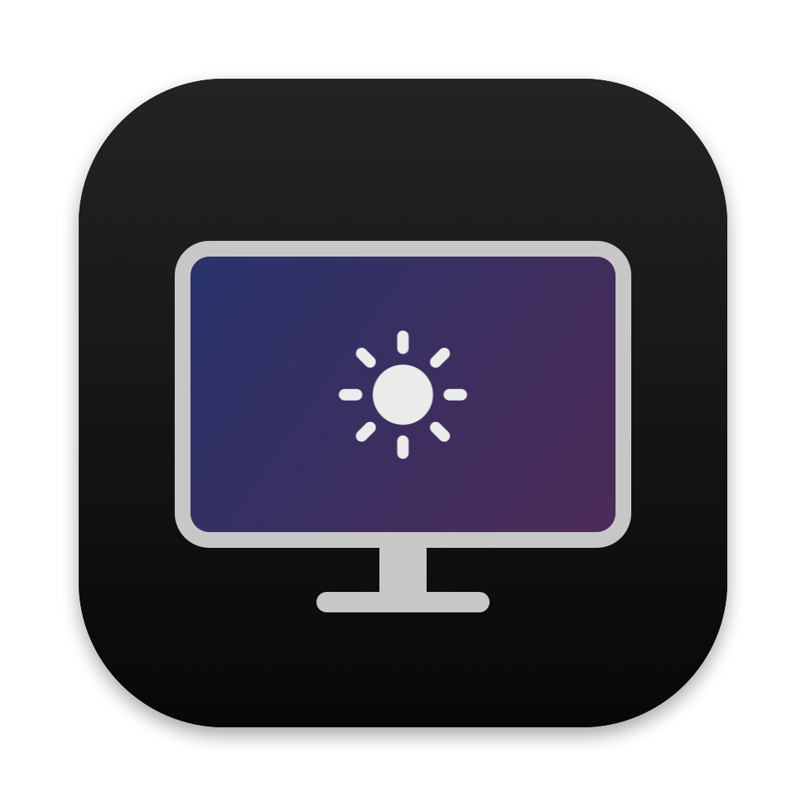

# Dell Control

A small menu bar app that controls a **Dell S2725QC** from a Mac: brightness, volume, contrast, sharpness, colour mode and RGB gains. It talks to the monitor directly over DDC/CI, the same channel the monitor's own joystick menu uses, so nothing is faked with software dimming.

I built it because BetterDisplay kept doing odd things to my brightness and Dell's own app felt clunky. It's made for one monitor on one Mac. It will probably work on other Dells with small changes, but I haven't tried.

Not affiliated with Dell. It uses three private Apple APIs (listed below), so a future macOS update could break it.

## What it does

- **Menu bar panel** in the style of Control Center: a Display card with brightness, a Sound card with volume, and a button into the full settings.
- **Settings window** with everything else: contrast, sharpness, colour mode, red/green/blue gains (in Custom Color only), follow-MacBook brightness, open at login.
- **Automatic colour profile.** Change the Dell's colour mode, from the app or the joystick, and within ten seconds macOS gets the ICC profile that describes that mode. sRGB mode gets Dell's sRGB profile; every other mode gets the native-gamut profile in [`Profiles/`](Profiles), which is bundled into the app. This is the same trick BenQ's "M-Book" mode and ASUS's "M Model P3" rely on: the monitor's mode and the Mac's profile have to agree, or colours come out over- or under-saturated.
- **Contrast: Accurate, More or Most.** An IPS panel's black is a glowing grey next to a mini-LED MacBook, and a matte coating spreads room light over it, so greys can look flat even when they measure right. More and Most use profiles that declare a lower panel gamma (2.10 and 2.02), so macOS renders everything on a steeper curve, effectively gamma 2.3 and 2.4. Shadows and mid-tones sit lower and the picture gets more depth. It's the same idea as the gamma 2.4 standard for dim-room viewing. Accurate is the one matched to the MacBook. I use Most: next to the MacBook it looks closest, even though Accurate measures closer.
- **Follow MacBook brightness.** The Dell follows the built-in screen as macOS dims and brightens it, auto-brightness included. "Match Brightness by Eye" sets the MacBook to 25, 50, 75 and 100%, and at each step you drag the Dell until the whites look equally bright. If you nudge the Dell by hand afterwards, that nudge is kept as an offset.
- **Command line**, mostly so scripts (and Claude) can test things without clicking:

  ```bash
  DC=~/Applications/"Dell Control.app"/Contents/MacOS/DellControl
  $DC get 10 62        # brightness and volume
  $DC set 10 40        # brightness to 40
  $DC caps             # the monitor's capabilities string
  $DC pattern          # test patches on every screen; also: pattern flat, pattern shadows
  $DC selftest         # packet, parser and brightness-curve checks
  ```

## Build and install

Needs an Apple silicon Mac, macOS 15 or later (I run 27.2), and the Command Line Tools (`xcode-select --install`). Xcode itself isn't needed.

```bash
./build.sh
```

That compiles in Swift 6 language mode, signs ad hoc, runs the self-test and copies the app to `~/Applications`. In the Dell's menu, **Others → DDC/CI** must be on.

The Custom Color profiles in [`Profiles/`](Profiles) are copied into the app when it builds. For the Dell's sRGB mode, put `Dell S2725QC sRGB (Dell official).icc` in `~/Library/ColorSync/Profiles`: that's Dell's `Dell_S2725QC_sRGB.icm` from their macOS driver package, renamed. It's Dell's file, so it isn't in this repo.

Copy them with Terminal or Finder. Files written by some sandboxed tools pick up a `com.apple.provenance` tag, and System Settings then hides them from its profile list (ColorSync still uses them).

## Things I learned about this monitor

This is the part that took longest, so it's written down in full.

**Capabilities string.** The Dell reports:

```
vcp(02 04 05 08 10 12 14(01 05 08 0B 0C) 16 18 1A 52 60(1B 11 12) 62(FF FE) 63(FF FD)
69(20 22 23 24 21 2F) 87 AA(00 01 02 04) AC AE B2 B6 C6(01) C8 C9 CA CC(…) D6(01 04 05)
DC(00 03 05) DF E0(03) E2(…) E3 EA(…) F0(…) F1 F2 FD) mccs_ver(2.1)
```

Useful codes: `10` brightness, `12` contrast, `14` colour preset, `16/18/1A` red/green/blue gain, `62` volume, `87` sharpness, `60` input (`1B` USB-C, `11` HDMI 1, `12` HDMI 2). There is no mute code.

**Colour presets.** `0x14` only accepts `01 05 08 0B 0C`. `0C` is **Custom Color**, the only mode where the RGB gains do anything. The Dell's own mode is mirrored in VCP `E2`:

| `0x14` | `0xE2` | Best guess at the Dell's name |
|---|---|---|
| `05` | `00` | Standard |
| `01` | `0B` | sRGB |
| `08` | `12` | Cool? |
| `0B` | `0E` | Warm? |
| `0C` | `14` | Custom Color (confirmed) |

Only Custom Color is confirmed against the Dell's menu.

**Timing.** The Dell silently drops a command that arrives less than about 50 ms after a write, and still answers "ok". `DDC.write` waits 60 ms after every write for that reason.

**Two programs at once.** If the app and the command line talk to the monitor at the same moment, replies get mixed up. A file lock (`$TMPDIR/dellcontrol-ddc.lock`) makes them take turns. With it, 80 back-to-back set-then-read cycles against a busy app missed none.

**The panel.** The S2725QS uses an LG Display LM270WR3-SSH1. DisplaySpecifications lists the S2725QC as a BOE MV270QUM-NY0-A940, but I couldn't confirm that, and neither macOS nor the monitor says which one it has. It's an edge-lit IPS with KSF red phosphor, about 20% wider than sRGB and well short of Display P3. Its EDID primaries cover roughly 84% of P3.

**Out of the box it runs warm.** RTINGS found "most grays have too much red" and noted it looks warm beside a MacBook; my own photo comparison agreed. Their calibrated gains are paywalled. PCMonitors' settings, quoted by SetupScore, are Custom Color with **R98 G100 B97** at about 56% brightness for roughly 6500 K. On my unit that measured too cool next to the MacBook, and the camera match below landed on **R100 G96 B85**. Units vary, so treat any of these numbers as a starting point.

## Matching a MacBook Pro

Matching only works against a MacBook that isn't moving:

- Turn off True Tone, Night Shift and "Automatically adjust brightness".
- Use the **Apple Display (P3-600 nits)** preset rather than the default "Apple XDR Display (P3-1600 nits)". That's what it's called on the M4; M1/M2 Pros had P3-500 nits instead. BenQ's M-Book recipe asks for the same thing.
- Match brightness first, then compare whites.

My MacBook is a 14-inch MacBook Pro with the M4 chip (2024), and a few things about it matter here:

- **Its factory profile has a D65 white** (x 0.3127, y 0.3290), measured for this particular panel. That's the target the Dell's Custom Color profile and gains aim for.
- **Its colour range is close to Display P3; the Dell's isn't.** The MacBook's green primary sits at about y 0.67, the Dell's at 0.61. Very saturated greens and cyans will always look a bit flatter on the Dell, and no setting fixes that.
- **The backlights differ.** The M4 uses a quantum-dot film (first reported by DSCC's Ross Young in November 2024); the Dell uses KSF phosphor. Two whites that measure the same can still look slightly different side by side when the light behind them has a different spectrum, so expect a small leftover difference even when the numbers agree.
- **SDR brightness goes past 600 nits only with auto-brightness on.** Apple quotes up to 1000 nits outdoors. Notebookcheck measured an M4 Pro 14 at 638 nits by hand and 1,070 with the light sensor in bright light. The Dell tops out around 350, so brightness following simply hits 100 when the MacBook is that bright.
- **True Tone reaches the Dell** while the MacBook's lid is open, so it has to be off for colour work or the Mac shifts the Dell's white too. I keep it off anyway.

## Calibrating with a camera

No colorimeter, so I used a Sony A6700 on a tripod, tethered over USB, with the MacBook as the reference. Its factory profile is measured for its own panel, with a D65 white. Both screens show the same patches in one frame, so whatever the camera does to colour, it does to both.

```bash
DC=~/Applications/"Dell Control.app"/Contents/MacOS/DellControl
swiftc -swift-version 5 Tools/sony-remote.swift -o build/sony-remote
swiftc -swift-version 5 Tools/analyze-photo.swift -o build/analyze-photo

build/sony-remote set D21E 400 4                 # ISO 400
build/sony-remote set 5007 400 2                 # f/4
build/sony-remote set D20D $(( (1<<16) | 25 )) 4 # 1/25 s
build/sony-remote set D222 17 2                  # save to the Mac as well as the card
$DC pattern flat &  ; build/sony-remote shoot Captures ; pkill -f "DellControl pattern"
$DC pattern &       ; build/sony-remote shoot Captures ; pkill -f "DellControl pattern"
FLAT=Captures/<flat>.ARW build/analyze-photo Captures/<pattern>.ARW "dell:TL TR BR BL" "mac:TL TR BR BL" boxes.png
```

`sony-remote` speaks Sony's PC Remote protocol through Apple's ImageCaptureCore, so nothing else needs installing. The camera has to be in PC Remote mode over USB. The flat shot matters a lot: without it, lens vignetting and the viewing angle made both screens look like gamma 1.5 at 85%.

What it found on my unit, at Dell brightness 8 in a dark room:

| | Before (R98 G100 B97) | After (**R100 G96 B85**) |
|---|---|---|
| White, red÷green vs MacBook | 0.84 | 1.01 |
| White, blue÷green vs MacBook | 1.19 | 1.01 |
| Grey brightness 85–40%, vs MacBook | within 2% | within 1% |
| Grey tint 85–25%, red÷green | within 6% | within 5% (55% grey is the worst) |

The gains act steeply. The Dell's light changes with roughly the 2.6th power of a gain, so one or two steps is a visible change.

A camera doesn't see colour the way eyes do, and these two screens make light differently (quantum dots against KSF phosphor). I only trusted the white because the camera agreed with my own eyes at two settings on either side of it. Shadows below about 20% aren't measured: the room wasn't dark enough at long exposures, and the Dell seems to dim its backlight when the whole screen is dark.

## How it's put together

| File | Job |
|---|---|
| `Sources/DDC.swift` | An actor on its own serial queue that speaks DDC/CI through `IOAVService` (private). Builds packets, parses replies, retries, holds the cross-process lock. |
| `Sources/Monitor.swift` | The main-actor model the UI reads. Coalesces slider drags so only the latest value is sent, and picks the colour profile. |
| `Sources/Follow.swift` | Brightness following: the calibration curve, the offset, the calibration steps. |
| `Sources/Displays.swift` | Finds the Dell and the built-in screen, reads and sets MacBook brightness (`DisplayServices`, private), assigns ICC profiles (ColorSync). |
| `Sources/App.swift` | The menu bar panel and Settings window, in SwiftUI. |
| `Sources/main.swift` | The command line and the self-test; launches the app when run with no arguments. |
| `Tools/sony-remote.swift`, `Tools/analyze-photo.swift` | Tethered Sony capture and the two-screen photo analysis (see above). `Tools/camera-capture.swift` is the plain ImageCaptureCore version, which can't fire a Sony's shutter. |
| `Tools/make-icon.swift` | Draws the icon. `swift Tools/make-icon.swift` rebuilds `Resources/AppIcon.icns`. |
| `Test Pages/` | `match-test.html` for comparing the two screens by eye, `photo-target.html` for photographing both screens side by side. |

Private APIs in use: `IOAVServiceCreateWithService` / `IOAVServiceReadI2C` / `IOAVServiceWriteI2C` (DDC), `DisplayServicesGetBrightness` / `DisplayServicesSetBrightness` (MacBook brightness), and `SLSDisplay…HDRMode` (probed, not yet used).

The Command Line Tools ship without SwiftUI's macro plugin, so `@State` won't compile. View state lives in the `@Observable` models instead, which do work.

## Not done yet

- **HDR toggle.** macOS currently reports the Dell as not supporting HDR in its 4K 120 Hz mode, so I haven't wired it up. Dell's manual also says brightness, contrast and the preset modes lock while it shows HDR content, so the app's writes would be ignored then anyway.
- **Brightness following** is untested with the lid open.
- The colour-mode names marked with a question mark above.

## Licence

MIT, see [LICENSE](LICENSE). The private Apple APIs and Dell's own ICC profile are not covered by it.
